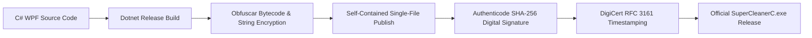

# Security Policy for Super Cleaner C

**Developer:** WEKA TEAM  
**Effective Date:** September 17, 2026  
**Last Updated:** November 20, 2026  
**Primary Contact:** [@Vandiom5](https://t.me/Vandiom5)

---

##  Security Overview & Philosophy

**Super Cleaner C** performs low-level operating system maintenance, driver shader optimization, browser engine cache clearing, and system integrity maintenance. Security, binary integrity, and data protection are central to every release built by **WEKA TEAM**.

This Security Policy outlines the cryptographic controls, system safeguards, update validation mechanisms, and vulnerability reporting procedures implemented in Super Cleaner C.

---

##  Supported Versions

We provide active security maintenance, vulnerability patches, and cloud configuration support according to the following version matrix:

| Version | Status | Release Date | Support Level |
| :--- | :---: | :---: | :--- |
| **v1.2.1** | 🟢 **Supported** | October 2026 | Active production release; receives full cloud updates and hotfixes. |
| **v1.2** | 🟢 **Supported** | August 2026 | Production release; upgrade to v1.2.1 recommended. |
| **v1.1** | 🟡 **Deprecated** | July 2026 | Limited support; upgrade to v1.2.1 recommended. |
| **v1.0** | 🔴 **End of Life** | June 2026 | Deprecated; blocked from remote configuration and activation. |
| **< v1.0** | 🔴 **Unsupported** | Beta / Pre-release | Revoked and disabled. |

---

##  Binary Integrity & Authenticity

To protect users against supply-chain tampering, unauthorized repackaging, and man-in-the-middle attacks, every official release of Super Cleaner C undergoes a strict cryptographic verification workflow:



### 1. Cryptographic Hash (SHA-256)
Every release on GitHub is published alongside an authoritative SHA-256 hash. Users can verify binary integrity using PowerShell:
```powershell
Get-FileHash -Path ".\SuperCleanerC.exe" -Algorithm SHA256
```

Official v1.2.1 Release Checksums:
```text
6bc5fc3ad9a26be7222ee1fd523f24eadd6f4e204add321a5298e8089a81ddc9 *SuperCleanerC.exe
78d26a1ab62d32d1a923216e63e48ccd3fe4c0c1cd37d0953fbf6386de209a42 *SuperCleanerC_v1.2.1.zip
```

### 2. Authenticode Code Signing
The executable is digitally signed using an enterprise Authenticode certificate issued to **WEKA TEAM** with SHA-256 hashing and an RFC 3161 compliant timestamp from DigiCert.
```powershell
Get-AuthenticodeSignature -FilePath ".\SuperCleanerC.exe" | Format-List
```
Verify that:
- `Status` equals **Valid**
- `SignerCertificate.Subject` contains **CN=WEKA TEAM**
- `TimeStamperCertificate` is valid and verified.

---

##  Network & Cloud Communication Security

- **Strict Transport Security:** All outgoing network traffic to cloud backends utilizes **HTTPS / TLS 1.2+** exclusively. Unencrypted HTTP traffic is rejected at the socket level.
- **Cloud Infrastructure Security:** Cloud communications interface directly with enterprise Google Firebase Realtime Database backends protected by rigorous server-side security rules.
- **Short Timeout Boundaries:** All outbound HTTP requests enforce strict timeouts to prevent hanging threads or potential connection leaks.
- **Offline Resilience:** If network connectivity drops or remote servers are unreachable, activated clients smoothly transition to local cryptographic validation tokens without exposing the user to downtime.

---

##  Local Data Protection & Cryptographic Licensing

- **Hardware Fingerprint Hashing:** The system's unique identifier is never stored or transmitted in raw form. It is generated by calculating an irreversible, one-way SHA-256 cryptographic hash over system hardware characteristics.
- **Local Storage Hardening:** License activation tokens are protected locally using strong cryptography and Windows DPAPI (Data Protection API) hardware locking:
  $$\text{Token} = \text{HMAC-SHA256}(\text{Key}, \text{HWID} \parallel \text{SecretSalt})$$
- **Anti-Clock Tampering:** The licensing engine validates sequential timestamps to prevent unauthorized trial extension via system date rollbacks.
- **Machine Revocation:** Compromised or pirated keys are revoked dynamically via cloud sync and persisted locally in an immutable state.

---

##  Secure Auto-Update Engine

Super Cleaner C includes a hardened auto-update engine that safeguards against malicious payload delivery:

1. **Remote Version Auditing:** The application retrieves update manifests directly over HTTPS from authenticated cloud endpoints.
2. **Payload Verification:** Downloaded update binaries (both `.exe` and compressed `.zip` packages) are verified against the published remote SHA-256 checksum prior to execution or extraction.
3. **Isolated Staging:** Temporary update files are downloaded into a secure staging directory, verified for code signatures and integrity hashes, and then swapped atomically.
4. **Mandatory & Silent Updates:** Security hotfixes can be deployed silently or flagged as mandatory when critical vulnerabilities are patched.

---

##  Code Protection & Anti-Reverse Engineering

To protect intellectual property, cryptographic salts, and anti-piracy mechanisms from decompilation (e.g. dnSpy, ILSpy, de4dot):

- **String & Resource Encryption (`HideStrings`):** Sensitive strings (including internal paths, diagnostic signatures, debugger detection targets like `x64dbg`/`dnspy`, cryptographic parameters, and API endpoints) are encrypted at the IL bytecode level.
- **Private Member & Security Obfuscation:** Internal fields, private methods, and core security services (e.g. `SecurityGuardService`, `ElevationService`) are obfuscated and symbol-stripped using **Obfuscar** while maintaining stable WPF data-binding and MVVM interfaces.
- **Dynamic Level-2 Cloud Protection:** Heartbeat verification flags debugger attachment or tampering in real-time, backed by Firebase Level-2 authorization rules preventing unauthenticated modifications or license scraping.
- **Control Flow & Integrity Hardening:** Critical routines (such as activation validation and hash comparison) utilize scrambled control flow blocks and sequential anti-rollback timestamp audits.
- **Single-File Bundling & Authenticode:** The application is packed as a self-contained single executable with native .NET 8 runtime bundling, signed with an enterprise SHA-256 Authenticode certificate.

---

##  Cleaning Engine Safety & System Protection

Super Cleaner C is engineered under strict non-destructive safety principles to preserve operating system stability:

- **Operating System Safeguard:** The **Visual Disk Space Analyzer** and **Military File Shredder** enforce hardcoded protections locking critical Windows system directories (`C:\Windows`, `C:\Program Files`, `C:\Program Files (x86)`, `C:\ProgramData`) and virtual memory containers (`pagefile.sys`, `swapfile.sys`, `hiberfil.sys`) against shredding or deletion.
- **Process Protection Safeguard:** The **Live System Monitor** actively protects core Windows system processes (`System` PID 4, `csrss.exe`, `smss.exe`, `wininit.exe`, `lsass.exe`) by refusing termination commands.
- **Multi-Pass Secure File Overwriting:** The **File Shredder** implements verified 1-pass zero-fill, 3-pass DoD 5220.22-M, and 7-pass military-grade overwrite patterns followed by Master File Table (MFT) renaming prior to unlinking, preventing file recovery software from reconstructing data.
- **Non-Destructive Duplicate Detection:** The **Duplicate Files Finder** evaluates file contents using SHA-256 cryptographic hashes and guarantees that at least one original verified file copy is always protected.
- **Sensitive Category Opt-In:** High-impact non-cache categories (`Windows Update & Old OS`, `Registry & Settings`, `Hibernation Reserve`, `Component Store`) default to unchecked, require manual user opt-in, and present interactive safety confirmation dialogs detailing consequences before execution.
- **Package Registration Validation:** Identifies and targets only orphaned deployment packages with verified zero active system associations, safeguarding critical application dependencies.
- **Native Subsystem Integration & Isolated Elevation:** Operating system maintenance routines interface directly through official Microsoft system APIs. Standard user privileges (`asInvoker`) are maintained by default, spawning an isolated elevated runner strictly for administrative repairs (SFC, DISM, Network reset) with live console streaming.
- **SQLite Database Optimization:** Safely vacuums and defragments SQLite database pages and WAL logs for closed browsers and desktop apps without touching user history or data.
- **System Restore Integration:** Users can automatically generate an official Windows System Restore Point prior to maintenance cycles with direct rollback access via `rstrui.exe`.
- **Data & Identity Quarantine:** Cleaning operations are strictly restricted to transient cache buffers, ensuring personal credentials, user sessions, saved passwords, and application states remain completely untouched.
- **Local Audit Receipts:** Transparent local audit logging of every cleanup and shred run, recording timestamps, space reclaimed, and item counts for user review.

---

##  Reporting a Vulnerability

We take reports of security vulnerabilities seriously and appreciate the efforts of security researchers. If you discover a vulnerability or security flaw, please adhere to our **Responsible Disclosure** guidelines:

### How to Report:
1. **Direct Telegram Contact:** Contact the lead developer via Telegram at [@Vandiom5](https://t.me/Vandiom5) ([https://t.me/Vandiom5](https://t.me/Vandiom5)).
2. **Include Key Details:**
   - Detailed description of the vulnerability.
   - Steps to reproduce the issue (proof-of-concept script, sample input, or screenshot).
   - Affected version(s).
   - Any proposed remediation or mitigation.
3. **Confidentiality:** Please do not disclose or publish details of the vulnerability publicly until a patch has been released and verified.

### Response SLA:
- **Initial Response & Acknowledgment:** Within **24 to 48 hours**.
- **Triage & Assessment:** Within **3 business days**.
- **Hotfix Release:** Critical vulnerabilities will be addressed in an emergency patch release within **7 days**.

---

<div align="center">
  <sub>Super Cleaner C Security Policy • Maintained by WEKA TEAM</sub>
</div>
